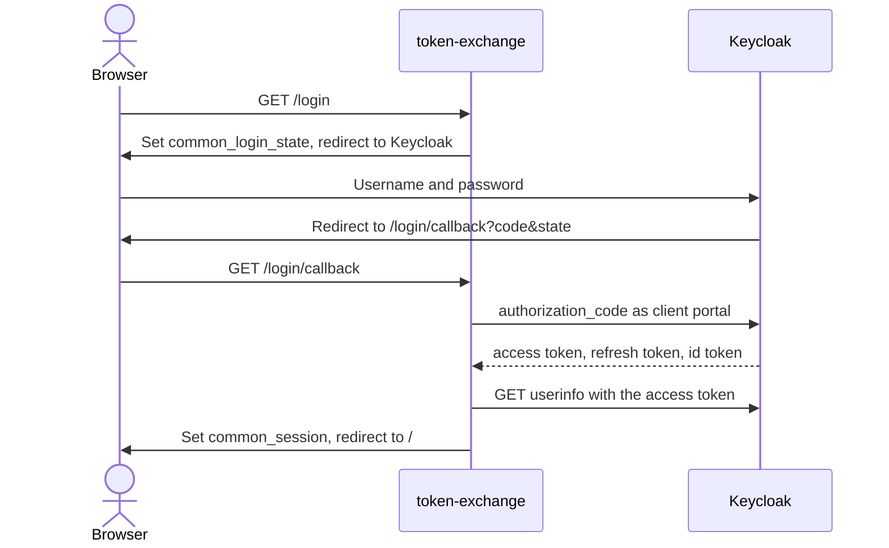
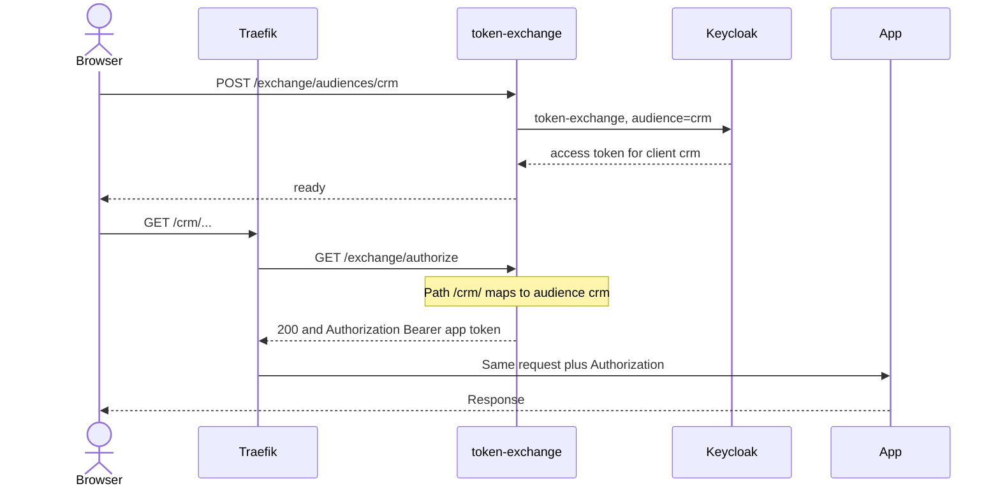
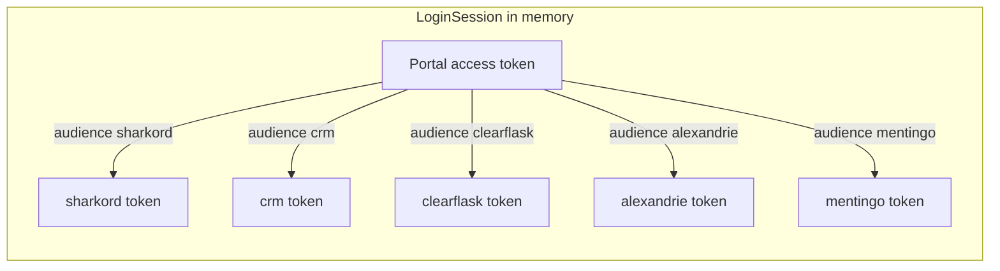
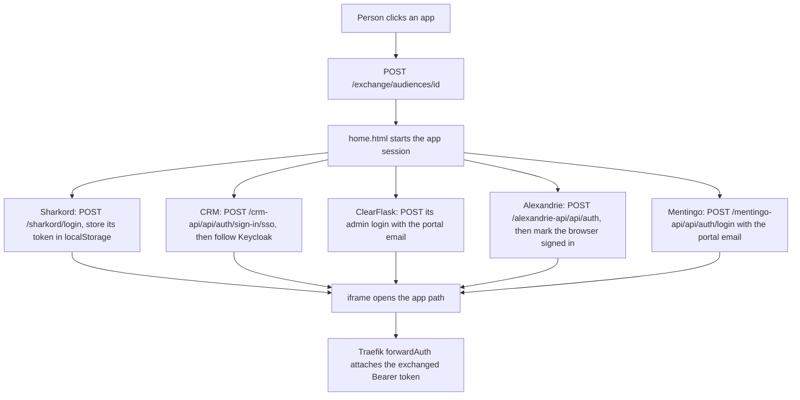

# Token exchange

The portal signs a person in once with Keycloak. Each app on `http://common.localhost` then receives its own access token. The browser never holds those tokens. It only holds a session cookie. The Java service in this folder asks Keycloak to exchange the portal token for an app token, and Traefik attaches that app token to the request.

## Pieces

| Piece | Role |
| --- | --- |
| Browser | Cookie `common_session`. No access token in JavaScript. |
| `LoginController` | Keycloak authorization-code sign-in and sign-out. |
| `SessionStore` | In-memory map from the cookie value to a `LoginSession`. Lost when the process restarts. |
| `KeycloakTokens` | Code grant, refresh, and RFC 8693 token exchange. |
| `AudienceCatalog` | Maps a request path to one app client. |
| `ExchangeController` | Traefik `forwardAuth` target, plus a warm-up call and an optional forward call. |
| `ExchangePermissionSetup` | On startup, allows the `exchange` client to exchange into each app client. |
| Traefik middleware `common-token` | Calls `GET /exchange/authorize` and copies the `Authorization` header upstream. |
| `home.html` | After the exchange is warmed, opens the app and starts that app's own session. |

Keycloak clients in realm `common`:

| Client | Used for |
| --- | --- |
| `portal` | The one browser sign-in. Standard authorization code. Secret `portal-secret`. |
| `exchange` | Server-side token exchange only. No browser login. Secret `exchange-secret`. |
| `sharkord`, `crm`, `clearflask`, `alexandrie`, `mentingo` | Audience of an exchanged access token. One client per app. |

## One sign-in

`addCodeGrant` stores three values on the session:

- **Access token** for client `portal`. This is the subject token for every later exchange. Lifetime comes from Keycloak (`expires_in`, realm default 3600 seconds).
- **Refresh token**. Used only to replace the portal access token.
- **ID token**. Sent back to Keycloak on sign-out as `id_token_hint`.

The cookie value is a random 32-byte hex id. It is `HttpOnly`, `SameSite=Lax`, path `/`, and lasts 8 hours. It is not a JWT.

## One portal token becomes one token per app

When the person opens an app, the page first calls `POST /exchange/audiences/{audience}`. That asks Keycloak for the app token and keeps it on the session. Traefik then does the same lookup for every later request to that app.

The exchange request (`KeycloakTokens.tokenFor`) is a form POST to Keycloak's token endpoint:

| Field | Value |
| --- | --- |
| `grant_type` | `urn:ietf:params:oauth:grant-type:token-exchange` |
| `subject_token` | The portal access token |
| `subject_token_type` | `urn:ietf:params:oauth:token-type:access_token` |
| `requested_token_type` | `urn:ietf:params:oauth:token-type:access_token` |
| `audience` | App client id, for example `crm` |
| `client_id` / `client_secret` | `exchange` / `exchange-secret` |

Keycloak checks that client `exchange` is allowed to exchange into that audience, then returns a new access token whose audience is the app. The portal token is not sent to the app.

A held app token is reused until 15 seconds before its expiry. If the portal access token is inside that same 15-second window, it is refreshed first with `grant_type=refresh_token` and client `portal`. A refresh drops every held app token, so the next request exchanges again from the new portal token.

`GET /exchange/authorize` returns:

- **401** with an empty body when `common_session` is missing. Traefik then blocks the app request.
- **200** with `Authorization: Bearer ...` when the path matches an app and the exchange succeeds.
- **200** with no `Authorization` header when the path is not an app, or when the exchange fails. The app request still goes through.

## Which path gets which token

`AudienceCatalog.findByRequestPath` reads `X-Forwarded-Uri` (or `X-Forwarded-Prefix`) from Traefik.

| Request path | Audience | Token sent upstream | Internal base, used only by `/exchange/forward` |
| --- | --- | --- | --- |
| `/sharkord` | `sharkord` | Bearer token for client `sharkord` | `http://sharkord:4991` |
| `/crm`, `/crm-api` | `crm` | Bearer token for client `crm` | `http://crm:3001` |
| `/clearflask` | `clearflask` | Bearer token for client `clearflask` | `http://clearflask-server:8080` |
| `/alexandrie`, `/alexandrie-api` | `alexandrie` | Bearer token for client `alexandrie` | `http://alexandrie-backend:8201` |
| `/mentingo`, `/mentingo-api` | `mentingo` | Bearer token for client `mentingo` | `http://mentingo-api:3000` |
| anything else | none | no exchanged token |  |

The browser service worker (`prefix-scope.js`) keeps an app iframe's requests under that app's prefix, so Traefik still selects the matching audience.

## What each app does with the token

Traefik adds the exchanged Bearer token on the way in. The five apps do not read that header to open their own screen. `home.html` starts a second, app-local session before the iframe loads. The portal session only decides *who* is signed in at Keycloak. The app session is what the app UI trusts.

| App | Exchanged Keycloak audience | Session the UI actually uses |
| --- | --- | --- |
| Sharkord | `sharkord` | Sharkord's own login token in `localStorage` |
| CRM | `crm` | CRM SSO redirect URL returned by its sign-in call |
| ClearFlask | `clearflask` | ClearFlask account cookie from its admin login |
| Alexandrie | `alexandrie` | Alexandrie `Authorization` cookie plus `isLoggedIn` in IndexedDB |
| Mentingo | `mentingo` | Mentingo login cookie from `/api/auth/login` |

`POST /exchange/forward` can call an app from the server with the exchanged Bearer token. The home page does not use that endpoint. The iframe path above is the one in use.

## Permission added at startup

Token exchange is refused unless Keycloak allows client `exchange` to ask for that audience. `ExchangePermissionSetup` runs when the service starts, up to six times:

1. Sign in to the master realm with the admin user.
2. For each audience, turn on management permissions on that client.
3. Add a client policy named `exchange-to-{audience}` that names the `exchange` client.
4. Attach that policy to the client's `token-exchange` scope permission.

If this step fails, `/exchange/authorize` still returns 200, but without a Bearer token, and the log contains the Keycloak error.
