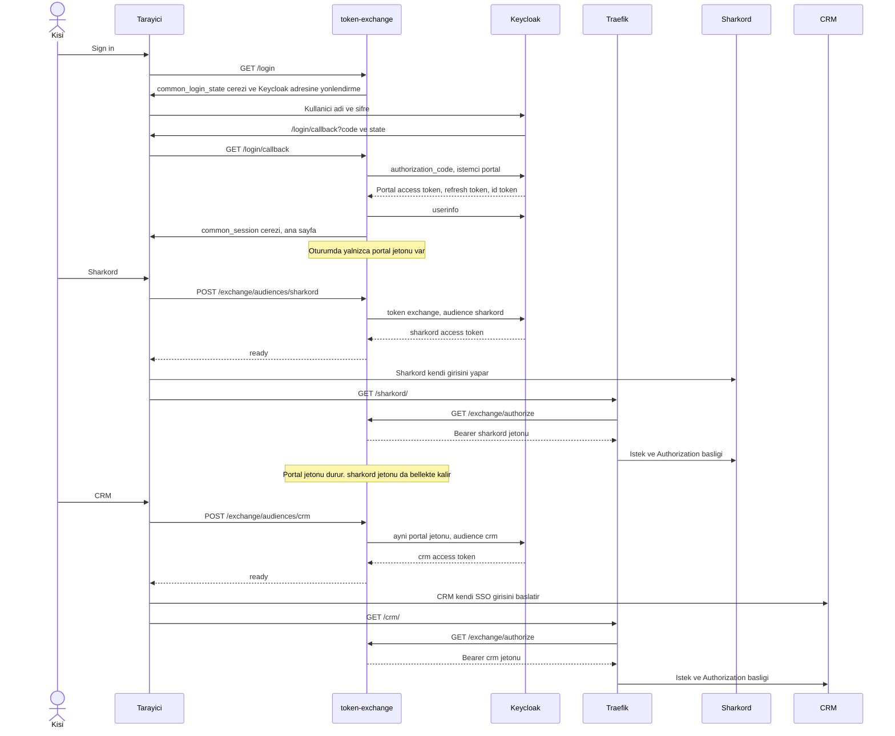
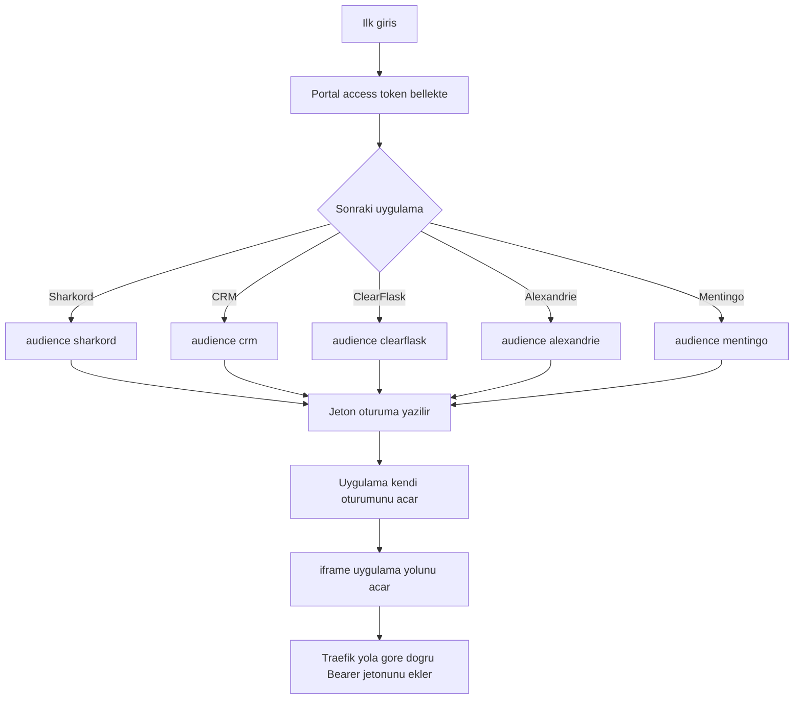

# Token exchange, Türkçe

Kişi `http://common.localhost` adresinde bir kez giriş yapar. `apps/token-exchange` içindeki Java servisi bu girişten bir portal jetonu alır. Her uygulamaya geçişte Keycloak'tan o uygulamaya ait ayrı bir access token ister. Tarayıcı bu jetonları tutmaz. Tarayıcıda yalnızca `common_session` çerezi vardır.

İngilizce karşılığı aynı klasördeki `README.md` dosyasıdır.

## İlk girişten sonraki uygulamaya

Aşağıdaki diyagram iki adımı birlikte gösterir: ilk Keycloak girişi, sonra Sharkord, ardından CRM. CRM yerine ClearFlask, Alexandrie veya Mentingo da aynı yoldan geçer. Değişen tek şey audience adıdır.

İkinci uygulamada kişi yeniden şifre yazmaz. Portal jetonu aynı kalır. Keycloak yalnızca yeni audience için yeni bir access token verir.

## Parçalar

| Parça | Görevi |
| --- | --- |
| Tarayıcı | `common_session` çerezi. JavaScript access token görmez. |
| `LoginController` | Keycloak authorization-code girişi ve çıkışı. |
| `SessionStore` | Çerez değerinden `LoginSession` kaydına giden bellek haritası. Süreç yeniden başlayınca silinir. |
| `KeycloakTokens` | Code grant, refresh ve RFC 8693 token exchange. |
| `AudienceCatalog` | İstek yolunu bir uygulama istemcisine bağlar. |
| `ExchangeController` | Traefik `forwardAuth` hedefi, jetonu önden isteme ve isteğe bağlı iletme. |
| `ExchangePermissionSetup` | Açılışta `exchange` istemcisinin her uygulama istemcisine jeton değiştirmesine izin verir. |
| Traefik `common-token` | `GET /exchange/authorize` çağırır ve `Authorization` başlığını upstream isteğe kopyalar. |
| `home.html` | Değişim ısındıktan sonra uygulamayı açar ve uygulamanın kendi oturumunu başlatır. |

Realm `common` içindeki Keycloak istemcileri:

| İstemci | Kullanım |
| --- | --- |
| `portal` | Tek tarayıcı girişi. Authorization code. Secret `portal-secret`. |
| `exchange` | Yalnızca sunucu tarafı token exchange. Tarayıcı girişi yok. Secret `exchange-secret`. |
| `sharkord`, `crm`, `clearflask`, `alexandrie`, `mentingo` | Değiştirilen access token'ın audience değeri. Her uygulamanın bir istemcisi vardır. |

## İlk girişte saklananlar

`addCodeGrant` oturuma üç değer yazar:

- **Access token.** İstemci `portal`. Sonraki her değişimin subject token değeridir. Ömrü Keycloak `expires_in` alanından gelir. Realm varsayılanı 3600 saniyedir.
- **Refresh token.** Yalnızca portal access token yenilenirken kullanılır.
- **ID token.** Çıkışta Keycloak'a `id_token_hint` olarak gider.

Çerez değeri 32 baytlık rastgele bir hex kimliktir. `HttpOnly`, `SameSite=Lax`, path `/`, ömür 8 saattir. Bu değer bir JWT değildir.

## Değişim isteği

Kişi bir uygulamaya bastığında sayfa önce `POST /exchange/audiences/{audience}` çağırır. `KeycloakTokens.tokenFor` Keycloak token ucuna şu formu gönderir:

| Alan | Değer |
| --- | --- |
| `grant_type` | `urn:ietf:params:oauth:grant-type:token-exchange` |
| `subject_token` | Portal access token |
| `subject_token_type` | `urn:ietf:params:oauth:token-type:access_token` |
| `requested_token_type` | `urn:ietf:params:oauth:token-type:access_token` |
| `audience` | Uygulama istemci adı, örneğin `crm` |
| `client_id` / `client_secret` | `exchange` / `exchange-secret` |

Keycloak, `exchange` istemcisinin bu audience için izinli olduğunu kontrol eder ve audience'ı o uygulama olan yeni bir access token döner. Portal jetonu uygulamaya gitmez.

Elde tutulan uygulama jetonu, bitmesine 15 saniye kalana kadar yeniden kullanılır. Portal access token da bu 15 saniyelik pencereye girdiyse önce `grant_type=refresh_token` ve istemci `portal` ile yenilenir. Yenileme, eldeki bütün uygulama jetonlarını siler. Bir sonraki istek yeni portal jetonundan tekrar değişir.

`GET /exchange/authorize` cevapları:

- **401** ve boş gövde. `common_session` yoktur. Traefik uygulama isteğini keser.
- **200** ve `Authorization: Bearer ...`. Yol bir uygulamaya denk gelir ve değişim başarılıdır.
- **200** ve `Authorization` başlığı yoktur. Yol bir uygulama değildir veya değişim başarısızdır. Uygulama isteği yine de gider.

## Hangi yol hangi jetonu alır

`AudienceCatalog.findByRequestPath`, Traefik'ten gelen `X-Forwarded-Uri` değerine bakar. Bu başlık yoksa `X-Forwarded-Prefix` kullanılır.

| İstek yolu | Audience | Upstream'e giden jeton | `/exchange/forward` için iç adres |
| --- | --- | --- | --- |
| `/sharkord` | `sharkord` | `sharkord` istemcisinin Bearer jetonu | `http://sharkord:4991` |
| `/crm`, `/crm-api` | `crm` | `crm` istemcisinin Bearer jetonu | `http://crm:3001` |
| `/clearflask` | `clearflask` | `clearflask` istemcisinin Bearer jetonu | `http://clearflask-server:8080` |
| `/alexandrie`, `/alexandrie-api` | `alexandrie` | `alexandrie` istemcisinin Bearer jetonu | `http://alexandrie-backend:8201` |
| `/mentingo`, `/mentingo-api` | `mentingo` | `mentingo` istemcisinin Bearer jetonu | `http://mentingo-api:3000` |
| diğer yollar | yok | değiştirilmiş jeton yok |  |

Tarayıcıdaki `prefix-scope.js`, iframe içindeki istekleri uygulamanın önekine taşır. Traefik böylece doğru audience'ı seçer.

## Uygulama ekranı hangi oturuma bakar

Traefik, değiştirilen Bearer jetonunu isteğin üzerine ekler. Beş uygulamanın ekranı bu başlığı okuyarak açılmaz. `home.html`, iframe yüklenmeden önce uygulamaya ait ikinci bir oturum başlatır. Portal oturumu Keycloak'ta kimin giriş yaptığını tutar. Uygulama arayüzü kendi oturumuna güvenir.

| Uygulama | Keycloak audience | Arayüzün kullandığı oturum |
| --- | --- | --- |
| Sharkord | `sharkord` | `localStorage` içindeki Sharkord giriş jetonu |
| CRM | `crm` | Kendi SSO çağrısının döndürdüğü Keycloak yönlendirmesi |
| ClearFlask | `clearflask` | Admin girişinden gelen ClearFlask hesap çerezi |
| Alexandrie | `alexandrie` | Alexandrie `Authorization` çerezi ve IndexedDB içindeki `isLoggedIn` |
| Mentingo | `mentingo` | `/api/auth/login` çağrısından gelen Mentingo çerezi |

`POST /exchange/forward`, sunucunun uygulamayı değiştirilen Bearer jetonu ile çağırması içindir. Ana sayfa bu ucu kullanmaz. Kullanılan yol yukarıdaki iframe yoludur.

## Açılışta eklenen izin

Keycloak, `exchange` istemcisi o audience için izinli değilse değişimi reddeder. Servis açılınca `ExchangePermissionSetup` en fazla altı kez şunları dener:

1. Master realm'de admin kullanıcı ile giriş.
2. Her audience için o istemcinin yönetim izinlerini açmak.
3. `exchange-to-{audience}` adlı ve `exchange` istemcisini gösteren bir client policy eklemek.
4. Bu policy'yi istemcinin `token-exchange` scope iznine bağlamak.

Bu adım başarısız olursa `/exchange/authorize` yine 200 döner, fakat Bearer jetonu olmadan. Keycloak hatası logda kalır.
